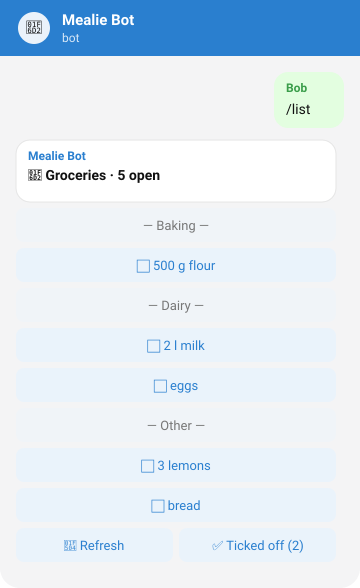
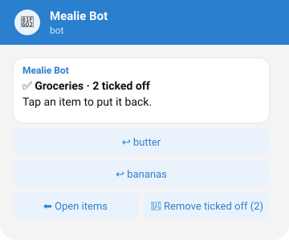

# mealie-telegram-bot

[](https://github.com/a-lex-s/mealie-telegram-bot/actions/workflows/ci.yml)
[](https://github.com/a-lex-s/mealie-telegram-bot/actions/workflows/release.yml)
[](https://github.com/a-lex-s/mealie-telegram-bot/releases)
[](pyproject.toml)
[](#compatibility)
[](LICENSE)

A Telegram bot that acts as a lightweight front end for a self-hosted
[Mealie](https://mealie.io) instance.

Version 1 is a shopping list helper for a small household: send items as a
message, tick them off with a tap, and everyone sees the same list in Mealie and
in Telegram. Recipes and meal plans may follow as separate, optional modules.

* English and German, chosen per user from the Telegram language
* Understands quantities and units: `2 l milk`, `500g flour`, `milk 2l`, `3x lemons`
* Uses Mealie's foods, units and labels, so items land in the right category
* Long polling only: no open port, no web server, no telemetry, no AI calls

The full behaviour is described in [docs/SPEC.md](docs/SPEC.md).

## How it looks

| Alice adds items | Bob ticks them off | Ticked-off items |
|---|---|---|
|  |  |  |

The pictures are mockups of the bot's messages; names and items are placeholders.

## Quick start

You need a running Mealie instance (see [Compatibility](#compatibility)),
Docker with Compose, and a Telegram account.

1. **Create a bot**: talk to [@BotFather](https://t.me/BotFather), send
   `/newbot` and note the token.
2. **Create a Mealie API token**: in Mealie, open the profile of the user the bot
   should act as and create a long-lived token under *API tokens*. A dedicated
   Mealie user for the bot keeps things tidy.
3. **Find your Telegram user IDs**: message [@userinfobot](https://t.me/userinfobot)
   from every account that may use the bot.
4. **Add the service** to the Compose stack that already runs Mealie. Copy
   [compose.example.yml](compose.example.yml), set the image tag (and digest),
   the network name and `ALLOWED_USER_IDS`, and put the two tokens into
   `secrets/telegram_bot_token` and `secrets/mealie_api_token`.
5. **Start it**: `docker compose up -d mealie-telegram-bot`. The log line
   `Connected to Mealie <version>` shows that the start-up check passed.
6. **Try it**: open the chat with your bot, send `/start`, then
   `2 l milk, eggs`, then `/list`.

Images are published as `ghcr.io/a-lex-s/mealie-telegram-bot:<tag>` for
`linux/amd64`; every [release](https://github.com/a-lex-s/mealie-telegram-bot/releases)
prints the image digest so you can pin it.

## Usage

| Command | German | What it does |
|---|---|---|
| `/start` | `/start` | Short introduction |
| `/list` | `/liste` | Show open items; tap one to tick it off |
| `/lists` | `/listen` | Choose which shopping list to use |
| `/clear` | `/aufraeumen` | Remove ticked-off items |
| `/help` | `/hilfe` | Show help |

Any other text message is added to the list, one item per line or separated by
commas. Quantities and units are optional and may come first or last:
`2 l milk`, `milk 2l`, `3x lemons`, `eggs 6`. Every spelling of a command works
for every user, whatever their language.

## Configuration

All configuration comes from environment variables. Every variable can instead
be read from a file by setting `<NAME>_FILE` (Docker or Compose secrets).

| Variable | Required | Default | Description |
|---|---|---|---|
| `TELEGRAM_BOT_TOKEN` | yes | | Telegram bot token |
| `MEALIE_API_TOKEN` | yes | | Mealie API token |
| `ALLOWED_USER_IDS` | yes | | Comma-separated Telegram user IDs |
| `MEALIE_URL` | no | `http://mealie:9000` | Mealie base URL as seen from the bot |
| `BOT_LANGUAGE` | no | per user | Force `en` or `de` for everybody |
| `SHOPPING_LIST` | no | first list | Default list, by name or ID |
| `FEATURE_SHOPPING` | no | `true` | Enable the shopping list feature |
| `MEALIE_TIMEOUT` | no | `10` | Mealie request timeout in seconds |
| `LOG_LEVEL` | no | `INFO` | `DEBUG`, `INFO`, `WARNING` or `ERROR` |

Invalid configuration stops the bot at start-up with exit code 2 and a message
that never contains secret values.

## Compatibility

| Component | Version | Notes |
|---|---|---|
| Mealie | 3.29.0 | Developed and verified against the OpenAPI document of this version; see [docs/SPEC.md](docs/SPEC.md#7-mealie-api-usage) for the endpoints used. Nearby 3.x releases are likely to work but are untested. |
| Python | 3.12 | Only 3.12 is supported (`requires-python = ">=3.12,<3.13"`). |
| aiogram | 3.x | Exact version pinned in `requirements.txt`. |
| httpx | 0.28.x | Exact version pinned in `requirements.txt`. |
| Docker image | `linux/amd64` | Based on `python:3.12-slim`, pinned by digest. |
| Telegram | Bot API, private chats | Groups receive only commands because of Telegram's privacy mode. |

To check the bot against your own Mealie version, download its OpenAPI document
and run the path test (see [Running locally](#running-locally)).

## Security

The bot is designed to run next to Mealie in a private Compose network with no
inbound port. In short:

* **Reach**: it only talks to the Telegram Bot API (outbound long polling) and
  to `MEALIE_URL`. No web server, no telemetry, no AI services.
* **Access**: only Telegram user IDs in `ALLOWED_USER_IDS` are served; every
  other update is dropped and the user ID is logged so an operator can add it.
* **Secrets**: tokens come from environment variables or `*_FILE` secrets. They
  are hidden in `repr`, redacted by the log handler and never part of error
  messages. gitleaks runs as a pre-commit hook and in CI on the full history.
* **Mealie side**: the bot acts as one Mealie user and can only see that user's
  household. Give it a dedicated user and a token you can revoke.
* **Container**: non-root user, read-only root file system, all capabilities
  dropped, `no-new-privileges`; see [compose.example.yml](compose.example.yml).
* **Supply chain**: dependencies locked with hashes, base image pinned by
  digest, GitHub Actions pinned by commit SHA, images built with provenance and
  SBOM.

Please report vulnerabilities privately as described in [SECURITY.md](SECURITY.md).

## FAQ

**Do I need to open a port or set up a webhook?**
No. The bot uses long polling, so it only makes outbound connections.

**Can I use my own Mealie user?**
Yes, but a dedicated user is better: everything the bot adds shows up in Mealie
under that user, and you can revoke its token without touching your own.

**Why does the bot ignore me?**
Your Telegram user ID is not in `ALLOWED_USER_IDS`. The log shows the ID at
`WARNING` level.

**Why does the bot not react to plain text in a group?**
Telegram's privacy mode only delivers commands to bots in groups. Use a private
chat per person; everyone still works on the same Mealie list.

**Which list is used?**
The one picked with `/lists`, otherwise `SHOPPING_LIST`, otherwise the first
list by name. The choice made with `/lists` resets when the bot restarts.

**Does the bot create foods, units or lists in Mealie?**
No. Unknown foods are stored as a note on the item; unknown units are kept as
part of the note; lists must exist in Mealie.

**Changes made in Mealie do not show up in Telegram.**
Tap *Refresh* or send `/list` again. There are no push notifications in version 1.

**Can I add recipes or a meal plan?**
Not yet. Version 1 is the shopping list only; the module structure leaves room
for more.

**How do I update?**
Change the image tag (and digest) in your Compose file and run
`docker compose up -d mealie-telegram-bot`. Releases are listed in
[CHANGELOG.md](CHANGELOG.md).

## Running locally

Requires Python 3.12. The same commands work under WSL.

```sh
python3.12 -m venv .venv
. .venv/bin/activate                # bash/zsh
# source .venv/bin/activate.fish    # fish
pip install --require-hashes -r requirements-dev.txt
pip install pre-commit && pre-commit install   # gitleaks + ruff before every commit

ruff check . && ruff format --check .
pytest

# Check the client against your Mealie's OpenAPI document (<MEALIE_URL>/openapi.json):
MEALIE_OPENAPI=path/to/openapi.json pytest tests/test_openapi_paths.py
```

Run the bot against a Mealie on `localhost`. With bash or zsh:

```sh
export TELEGRAM_BOT_TOKEN_FILE=./secrets/telegram_bot_token
export MEALIE_API_TOKEN_FILE=./secrets/mealie_api_token
export MEALIE_URL=http://localhost:9000
export ALLOWED_USER_IDS=123456789
python -m mealie_bot
```

With fish:

```fish
set -x TELEGRAM_BOT_TOKEN_FILE ./secrets/telegram_bot_token
set -x MEALIE_API_TOKEN_FILE ./secrets/mealie_api_token
set -x MEALIE_URL http://localhost:9000
set -x ALLOWED_USER_IDS 123456789
python -m mealie_bot
```

`secrets/` is ignored by git. To run the container instead of the venv against
a Mealie on `localhost`, use the commented variant in
[compose.example.yml](compose.example.yml).

Dependencies are declared in `pyproject.toml` and locked with hashes:

```sh
uv pip compile pyproject.toml --python-version 3.12 --generate-hashes --no-header -o requirements.txt
uv pip compile requirements-dev.in --python-version 3.12 --generate-hashes --no-header -o requirements-dev.txt
```

## Extending

* **Adding a language**: copy `mealie_bot/i18n/en.py`, translate messages,
  command names and unit spellings, and register it in
  `mealie_bot/i18n/__init__.py`. The tests check that the catalog is complete.
* **Adding a feature**: create a package under `mealie_bot/features/` that
  exports a `Feature`, add it to `available_features()` and to `KNOWN_FEATURES`
  in `config.py`. It is then switched with `FEATURE_<NAME>`.

## Contributing

See [CONTRIBUTING.md](CONTRIBUTING.md). In short: Conventional Commits, every
change as a pull request with tests, squash merge to `main`, CI must be green,
and no personal data anywhere in the repository.

## Releases

1. Bump `version` in `pyproject.toml` and `__version__` in `mealie_bot/__init__.py`
   in a pull request and merge it.
2. Tag the merge commit on `main` and push the tag:
   `git tag v0.1.0 && git push origin v0.1.0`.
3. The release workflow runs CI, then publishes
   `ghcr.io/a-lex-s/mealie-telegram-bot:v0.1.0` (and `:v0.1`). The image digest
   is shown in the workflow summary; deploy by tag and digest.

## License

[MIT](LICENSE)
