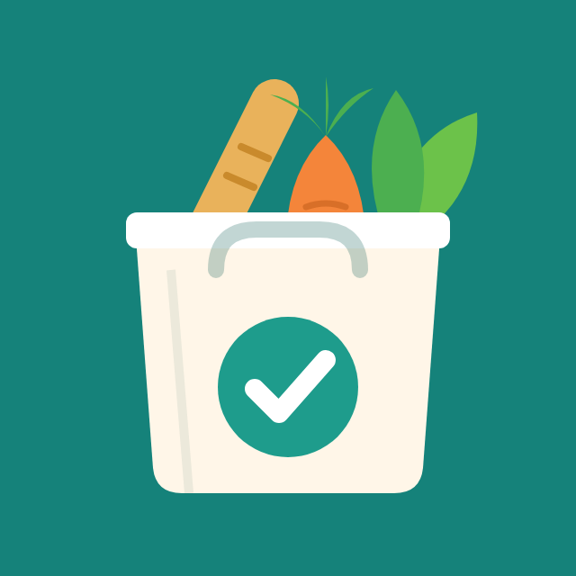
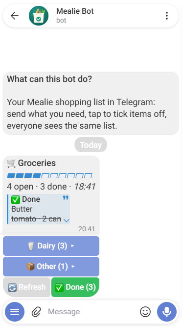
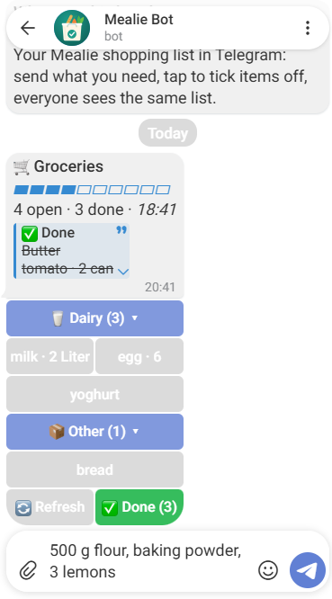
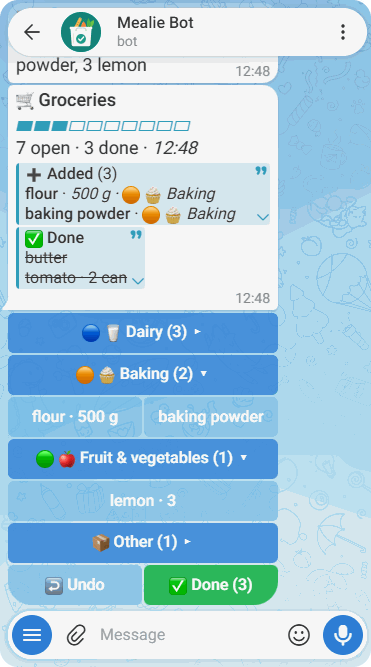

# mealie-telegram-bot

A shared shopping list for your household in Telegram, backed by a
self-hosted [Mealie](https://mealie.io) instance. Send what you need, tick it
off with a tap, and everyone sees the same list in Telegram and in Mealie.

* One private chat per person or one shared group, always in sync
* Understands quantities and units: `2 l milk`, `500g flour`, `3x lemons`
* Sorts items by Mealie's foods and labels
* English and German, chosen per user
* Long polling only: no open port, no telemetry, no AI calls

Version 1 covers shopping lists. Recipes and meal plans may follow as optional
modules.

## How it looks

| The list | A category opened | Items added |
|---|---|---|
|  |  |  |

## Quick start

You need a running Mealie instance (see [compatibility](docs/compatibility.md)),
Docker with Compose, and a Telegram account.

1. **Create a bot** with [@BotFather](https://t.me/BotFather) (`/newbot`) and
   note the token. A profile picture is in
   [docs/avatar/bot-avatar.png](docs/avatar/bot-avatar.png) (`/setuserpic`).
2. **Create a Mealie API token** under *Profile → API tokens*, ideally for a
   dedicated Mealie user.
3. **Find your Telegram user IDs** with [@userinfobot](https://t.me/userinfobot),
   or read them from the `WARNING` line the bot logs for unknown users.
4. **Configure** from [compose.example.yml](compose.example.yml): set the image
   tag and `ALLOWED_USER_IDS`, and put the tokens into
   `secrets/telegram_bot_token` and `secrets/mealie_api_token`
   (`chmod 644 secrets/*`, the container runs as UID 10001). The file covers
   Mealie in the same Compose network, a remote Mealie over HTTPS and local
   testing.
5. **Start** with `docker compose up -d mealie-telegram-bot` and look for
   `Connected to Mealie <version>` in the log.
6. **Try it**: send `/start`, then `2 l milk, eggs`.

Images: `ghcr.io/a-lex-s/mealie-telegram-bot:<tag>` (`linux/amd64`). Each
[release](https://github.com/a-lex-s/mealie-telegram-bot/releases) lists the
digest for pinning. All settings: [docs/configuration.md](docs/configuration.md).

## Usage

| Command | German | What it does |
|---|---|---|
| `/start` | `/start` | Short introduction |
| `/list` | `/liste` | Show the list; tap a category to open it, tap an item to tick it off |
| `/lists` | `/listen` | Choose which shopping list to use |
| `/clear` | `/aufraeumen` | Remove ticked-off items (asks first) |
| `/category` | `/kategorie` | Create a category |
| `/categories` | `/kategorien` | Show all categories |
| `/help` | `/hilfe` | Show help |
| `/version` | `/version` | Show the version and, in release images, the commit (not in the command menu) |

Any other message adds items, one per line or separated by commas. The list
then shows what was added, with an *Undo* button.

A line with an arrow sorts products into a category, for good:
`Ketchup → Condiments` (also `->`, `=>` or `>`, several products with commas). A new
category or an unknown product is created after a short question. Category
buttons show the label's colour from Mealie as a circle (`🟣 🧂 Condiments`);
`LABEL_ICONS` switches circles or emojis off.

## Documentation

* [Configuration](docs/configuration.md): all environment variables and `*_FILE` secrets
* [Compatibility](docs/compatibility.md): Mealie, Python, image and Telegram versions
* [Security](docs/security.md): what the bot can reach, how access and secrets are handled
* [FAQ](docs/faq.md): ports, groups, which list is used, updating
* [Development](docs/development.md): running the bot locally (bash and fish), releases
* [Specification](docs/SPEC.md): the complete behaviour, kept in sync with the code

## Contributing

Contributions are welcome, see [CONTRIBUTING.md](.github/CONTRIBUTING.md). Please
report security issues privately as described in [SECURITY.md](.github/SECURITY.md).

## License

[MIT](LICENSE)
