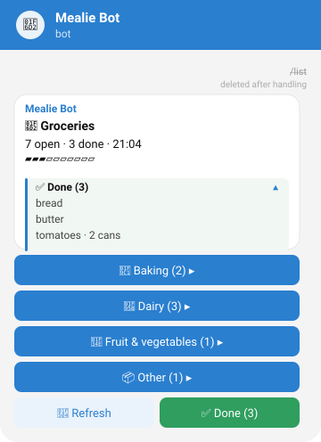
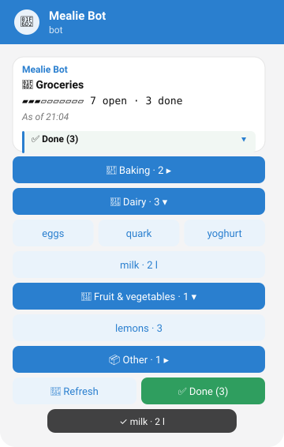
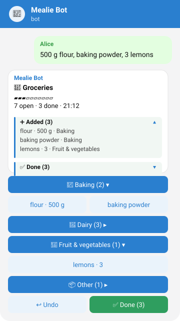

# mealie-telegram-bot

A Telegram bot that acts as a lightweight front end for a self-hosted
[Mealie](https://mealie.io) instance.

Version 1 is a shopping list helper for a small household: send items as a
message, tick them off with a tap, and everyone sees the same list in Mealie and
in Telegram. Recipes and meal plans may follow as separate, optional modules.

* English and German, chosen per user from the Telegram language
* Understands quantities and units: `2 l milk`, `500g flour`, `milk 2l`, `3x lemons`
* Uses Mealie's foods, units and labels, so items land in the right category
* Long polling only: no open port, no web server, no telemetry, no AI calls

## How it looks

| The list | A category opened | Alice adds items |
|---|---|---|
|  |  |  |

Mockups of the bot's messages; names and items are placeholders. Real
screenshots replace them as described in
[docs/screenshots/README.md](docs/screenshots/README.md). The chat stays
tidy: there is one live list message that the bot edits in place, taps answer
with short toasts, and when the list moves down the old message turns into a
compact history entry (`21:12 · Alice ➕ flour · 500 g, baking powder`).

## Quick start

You need a running Mealie instance (see [compatibility](docs/compatibility.md)),
Docker with Compose, and a Telegram account.

1. **Create a bot**: talk to [@BotFather](https://t.me/BotFather), send
   `/newbot` and note the token.
2. **Create a Mealie API token**: in Mealie, open the profile of the user the bot
   should act as and create a long-lived token under *API tokens*. A dedicated
   Mealie user for the bot keeps things tidy.
3. **Find your Telegram user IDs**: message [@userinfobot](https://t.me/userinfobot)
   from every account that may use the bot, or start the bot with a placeholder
   ID and read the real one from the `WARNING` line it logs for unknown users.
4. **Add the service**: copy [compose.example.yml](compose.example.yml), set
   the image tag (and digest) and `ALLOWED_USER_IDS`, and put the two tokens
   into `secrets/telegram_bot_token` and `secrets/mealie_api_token`. The file
   has three variants: next to Mealie in the same Compose network
   (`MEALIE_URL=http://mealie:9000`), standalone on any host against a Mealie
   reachable over HTTPS (`MEALIE_URL=https://mealie.example.com`), and a
   commented one for local testing against a Mealie on `localhost`.
5. **Start it**: `docker compose up -d mealie-telegram-bot`. The log line
   `Connected to Mealie <version>` shows that the start-up check passed.
6. **Try it**: open the chat with your bot, send `/start`, then
   `2 l milk, eggs`, then `/list`.

Images are published as `ghcr.io/a-lex-s/mealie-telegram-bot:<tag>` for
`linux/amd64`; every [release](https://github.com/a-lex-s/mealie-telegram-bot/releases)
prints the image digest so you can pin it. All settings are listed in
[docs/configuration.md](docs/configuration.md).

## Usage

| Command | German | What it does |
|---|---|---|
| `/start` | `/start` | Short introduction |
| `/list` | `/liste` | Show the list; tap a category to open it, tap an item to tick it off |
| `/lists` | `/listen` | Choose which shopping list to use |
| `/clear` | `/aufraeumen` | Remove ticked-off items (asks first) |
| `/help` | `/hilfe` | Show help |

Any other text message is added to the list, one item per line or separated by
commas. Quantities and units are optional and may come first or last:
`2 l milk`, `milk 2l`, `3x lemons`, `eggs 6`. The list then appears right below
your message with what was added and an *Undo* button.

## Documentation

* [Configuration](docs/configuration.md): all environment variables and `*_FILE` secrets
* [Compatibility](docs/compatibility.md): Mealie, Python, image and Telegram versions
* [Security](docs/security.md): what the bot can reach, how access and secrets are handled
* [FAQ](docs/faq.md): ports, groups, which list is used, updating
* [Development](docs/development.md): running the bot locally (bash and fish), releases
* [Specification](docs/SPEC.md): the complete behaviour, kept in sync with the code

## Contributing

See [CONTRIBUTING.md](CONTRIBUTING.md). In short: Conventional Commits, every
change as a pull request with tests, squash merge to `main`, CI must be green,
and no personal data anywhere in the repository. Security issues go through
[SECURITY.md](SECURITY.md).

## License

[MIT](LICENSE)
